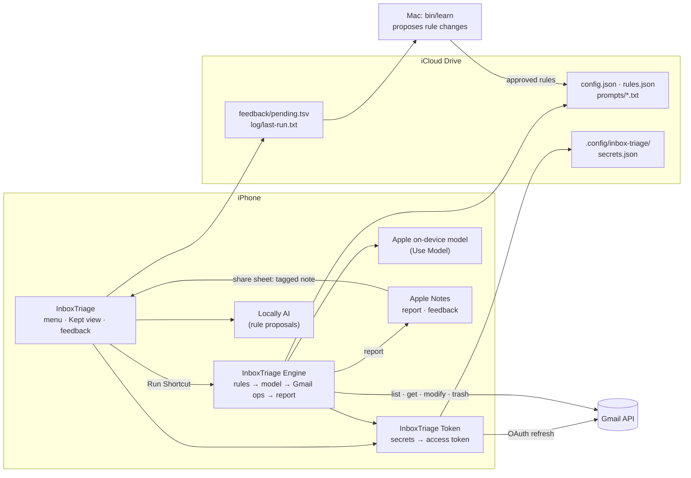

# Inbox Triage

**An iPhone Shortcut that triages a Gmail inbox with Apple's on-device model, and learns from your corrections.**

Every morning and evening it reads new inbox mail, decides what each message deserves, and leaves you a short report in Apple Notes. It can keep, archive, delete, unsubscribe or summarize a message. You correct its mistakes by typing a two-letter code in that note, and the corrections turn into rules after you approve them. Message text never leaves the phone: classifying and summarizing run on Apple's on-device model.

The three shortcuts (about 1,600 actions) are not built by hand. A Python generator writes them as property lists and signs them with `shortcuts sign`, and a test suite checks the generated plists against a list of failure modes found on a real iPhone.

> Built for the EECS 498 AASE (Agentic Software Engineering) project showcase, Fall 2026.

## Demo

*Screenshots coming soon: a dry-run report, a tagged note, and the proposed-rules note.*

A report line looks like this. Type a code in front of it to correct it:

```text
xm this is regular work business) Department Office — Faculty Meeting: Friday, Noon · KEEP · keep · model · id:18f3c2a9e0b4d7c1
```

## How it works



1. **InboxTriage** is what you run. It shows a menu (Open last review, Default, Kept, Custom, Apply feedback, Review proposed rules, Clean up old reports). A time-of-day automation runs it with the input `default`, which skips the menu.
2. **InboxTriage Engine** lists up to 25 inbox messages older than `ignoreHours`, skipping ones already marked Kept. For each message:
   - **Rules first.** Sender rules (from address, optionally with a subject) and content keyword rules from `rules.json`.
   - **Then the model.** Apple's on-device model, with prompts read from iCloud Drive at run time. Low confidence, IMPORTANT and STARRED mean the message is kept.
   - **Decision.** One of KEEP, ARCHIVE, DELETE, UNSUBSCRIBE or SUMMARIZE (low, moderate, high or confirmations), turned into a Gmail operation and a line in the report.
3. **InboxTriage Token** reads the OAuth secrets from iCloud Drive and returns a one-hour Gmail access token.

Details: [docs/ARCHITECTURE.md](docs/ARCHITECTURE.md).

## Safety by design

- **Dry run first.** `dryRun` starts `"true"`: the report says *Would archive, Would delete…*, and Gmail is untouched.
- **Separate switches.** Moving to Trash needs `allowDelete` and unsubscribing needs `allowUnsubscribe`. Both start off, and deletes become archives until you turn them on.
- **Keep on doubt.** Low model confidence, IMPORTANT or STARRED labels, an unreadable message, or unparseable model output all mean KEEP.
- **Reversible.** Every change also adds the Gmail label `AutoTriage` (search `label:AutoTriage` to undo), and Trash keeps mail for 30 days.
- **Unsubscribe is narrow.** It only sends the standard RFC 8058 one-click POST, never with your Gmail token. For mailto-only lists it creates a Gmail **draft** that you send yourself. It never opens other links.
- **People stay in charge of rules.** Model-proposed rule changes are only proposals: you approve or reject each one on the review page (or with `bin/learn` on the Mac). The old `rules.json` is backed up before every change.
- **Private by default.** Classification and summaries run on the phone. Secrets live in iCloud Drive, not in the shortcuts or this repo (see [SECURITY.md](SECURITY.md)).

## The feedback loop

After each run the **review page** opens in the browser: a card per message with decision buttons and a hint field, and one Submit that hands the corrections back to the shortcut. The data rides in the link after `#`, so it never reaches a server. Or, in the report note, start a line with a code, an optional hint, and `)`, then share the note to InboxTriage:

| Code | Meaning |
|---|---|
| `xk)` | keep: back to the inbox, marked Kept |
| `xa)` | archive |
| `xd)` | delete (archive while `allowDelete` is off) |
| `xl)` `xm)` `xh)` | summarize at low / moderate / high interest |
| `xc)` | summarize as a confirmation |
| `xu)` | unsubscribe |
| `xr)` | release from Kept: triage it again next run |
| `xt)` | tag only: add the hint's tag as a Gmail label |

Start a hint with a tag and a semicolon, `LoR; student requesting a letter of recommendation`, to label the message `LoR` in Gmail; the rest of the hint goes to the rule proposals, and approved rules can carry the tag.

The shortcut applies each correction, records it in `feedback/pending.tsv`, and asks **Locally AI** (a local LLM app) to propose rule changes from the corrections and your hints. The proposals are only written down. On the Mac, `bin/learn` turns the feedback into a reviewed diff of `rules.json`. Details: [docs/FEEDBACK.md](docs/FEEDBACK.md).

## Setup

Short version (full steps in [docs/SETUP.md](docs/SETUP.md)):

1. Create a Google Cloud project, enable the Gmail API, and create a **Desktop** OAuth client. Publish the consent screen so refresh tokens don't expire after 7 days.
2. On a Mac, run `bin/gmail-auth`. It signs you in, prints the refresh token, and creates the `AutoTriage` and `AutoTriage/Kept` labels. Put the three secrets in `iCloud Drive/.config/inbox-triage/secrets.json`.
3. Optionally, copy `icloud/config.example.json` and `icloud/rules.example.json` to `local/` and edit them. `local/` is gitignored.
4. Run `bin/build-shortcut` (generate and sign) and `bin/deploy` (copy to iCloud Drive).
5. On the iPhone, import in this order: **InboxTriage Token**, **InboxTriage Engine**, **InboxTriage**. Use the files `bin/deploy` put in iCloud Drive, or the signed `InboxTriage-0.1.0.zip` from [Releases](https://github.com/marcus-darden/inbox-triage/releases). Run it once and grant the access prompts.
6. Add a Time of Day automation: *Run Shortcut* **InboxTriage** with the input `default`.

Requirements: iPhone with Apple Intelligence (iOS 26+), a Gmail account, a Mac (to generate and sign), and optionally [Locally AI](https://locallyai.app) for rule proposals.

## Repository

```text
bin/build-shortcut   Python generator: writes and signs the three .shortcut files
bin/deploy           copies config, rules, prompts and shortcuts to iCloud Drive (never overwrites your own)
bin/gmail-auth       one-time OAuth sign-in (loopback + PKCE), creates the Gmail labels
bin/learn            proposes rules.json changes from your feedback; --apply after approval
bin/triage-table     prints the last run as a Markdown table
bin/build-demo       builds InboxTriage Demo: three Notes with made-up messages, for screenshots
icloud/              example config, example rules, and the prompts the model reads
tests/               pytest: plist invariants, regex patterns, bin/learn
docs/                architecture, setup, feedback, lessons learned, the review page, and the OAuth home and privacy pages
```

Development: `pip install pytest ruff && ruff check . && pytest`. CI runs both on every push. Signing needs macOS (`shortcuts sign`).

## Limitations

- iPhone only for running, and a Mac to generate and sign. Shortcuts has no supported API, so the plist format comes from Apple's own Gallery shortcuts and community references, and is checked on a device.
- Gmail only. The iOS Mail app's Shortcuts actions can read but not archive or delete.
- Gmail's iPhone app has no link that opens a specific message. Report links open the message in Apple Mail (`message://`), which needs the Gmail account added to Mail.
- The on-device model is small. It mislabels promotions as "a person" and invents deadlines; rules and feedback fix what prompts can't.
- Notes can't report checklist ticks back to Shortcuts, so feedback is typed rather than ticked.

## Built with Claude Code

I designed this project and made the decisions; the code was written with Claude Code (Anthropic's coding agent) in one long session, driven from my phone. That included researching Apple's private plist formats, writing the generator and tests, and debugging from my screenshots. Every claim about how Shortcuts behaves was checked on my iPhone, and [docs/LESSONS.md](docs/LESSONS.md) lists what we learned the hard way.

## License

MIT. See [LICENSE](LICENSE).
